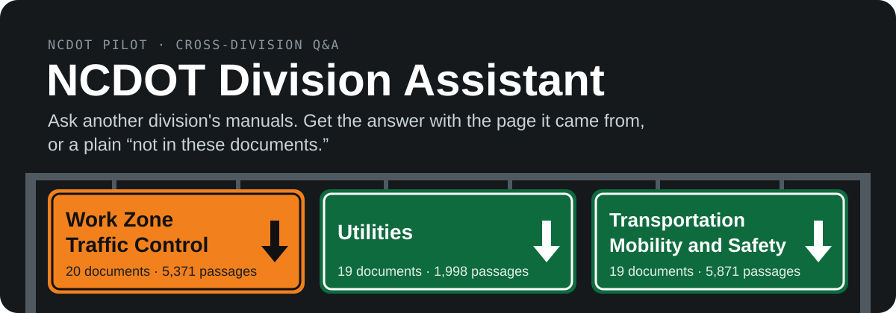
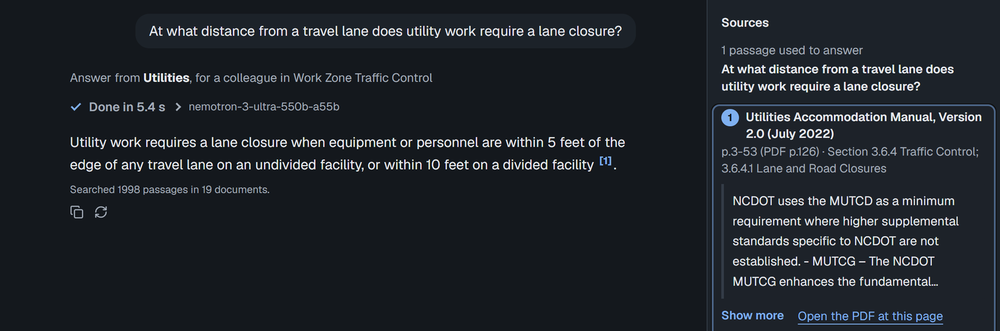
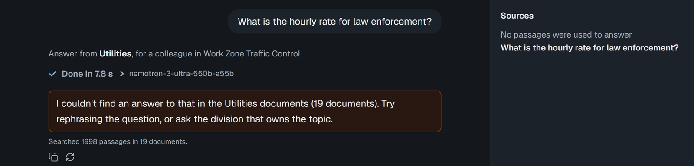
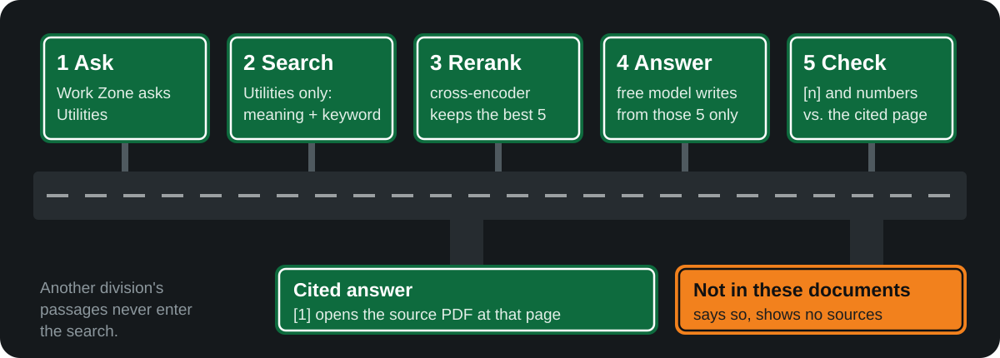

<p align="center">
  <a href="https://ncdot-division-assistant.vercel.app"></a>
</p>

<p align="center">
  <a href="https://ncdot-division-assistant.vercel.app"><b>Try the live demo</b></a> ·
  <a href="#how-it-works">How it works</a> ·
  <a href="#measured-results">Measured results</a> ·
  <a href="#run-it-locally">Run it locally</a>
</p>

A pilot for the North Carolina Department of Transportation. Someone in one division asks a question, and the answer comes only from another division's public NCDOT documents, with a citation to the document, page and section that opens the PDF at that page. When those documents don't cover the question, the assistant says so and shows no sources.

## See it answer

A Work Zone Traffic Control user asks the Utilities documents, on the live demo (9 November 2026):

<p align="center">
  
</p>

The `[1]` opens the passage in the Sources panel, and "Open the PDF at this page" goes to PDF page 126. A question the Utilities documents don't cover gets a refusal and no sources, not a guess:

<p align="center">
  
</p>

## How it works

<p align="center">
  
</p>

- **Only the asked division.** The division filter is applied inside the search, so another division's passages never reach the reranker or the model.
- **Meaning and keywords, then a rerank.** The top 40 passages by meaning (bge-small) and the top 40 by keywords (BM25) are merged, and an ONNX cross-encoder picks the 5 the model sees.
- **Checked citations.** Each `[n]` is renumbered to one document page, and every number in the answer is checked against the passages it cites. An answer that still cites nothing is shown with a "No source cited" flag.
- **Free models by default, OpenAI by choice.** The answer comes from a free model on OpenRouter, and paid OpenRouter models are refused at startup. With `LLM_PROVIDER=openai` and `OPENAI_API_KEY`, OpenAI's `gpt-6.1-terra` writes the answer instead, and the free models take over whenever OpenAI can't answer (key missing or rejected, budget spent, rate limit, outage). OpenAI spending is held under $50 a month: past $45 of estimated spend the free models answer until the month ends.

## Measured results

From the evaluation run of 27 October 2026: 90 questions on the Work Zone and Utilities documents, before Transportation Mobility and Safety was added. [`evaluation/RESULTS.md`](evaluation/RESULTS.md) has every metric with its confidence interval, and [`evaluation/METRICS.md`](evaluation/METRICS.md) defines them.

| Measure | Result |
|---|---|
| Faithfulness (claims supported by the passages) | **0.99** |
| Right PDF page among the 5 passages | **0.96** |
| Correct refusals (questions the documents don't answer) | **5 of 5** |
| Median answer time, question to checked answer | **2.1 s** |

## Run it locally

Needs `OPENROUTER_API_KEY` in `.env` (or `OPENAI_API_KEY` with `LLM_PROVIDER=openai`, see [Answering with OpenAI](#answering-with-openai)):

```bash
.venv\Scripts\python -m pip install -r hosted/requirements.txt
.venv\Scripts\python -m uvicorn index:app --app-dir hosted --env-file .env --port 8000
```

Build the page once (and after changing `hosted/web/`), then open http://localhost:8000:

```bash
cd hosted/web
npm ci
npm run build    # writes hosted/public/
npm run dev      # or a live-reloading copy on http://localhost:5173, calling the app on :8000 for /api
```

The first question downloads the two ONNX models (about 90 MB) into the system temp directory, unless `hosted/models/` exists (`.venv\Scripts\python hosted/scripts/fetch_models.py` fills it) or `MODEL_CACHE_DIR` points at a copy. `hosted/RESULTS-local.md` has the results of real questions against the local app.

## What's in the repository

**`hosted/` is the deployed app.** It is self-contained so it can be deployed on its own (Vercel Root Directory = `hosted`):

| Path | What it is |
|---|---|
| `hosted/index.py` | FastAPI app (`app`): `GET /` page, `GET /api/divisions`, `POST /api/warm`, `POST /api/ask`, `POST /api/ask/stream`, `GET /api/health` |
| `hosted/web/` | the page: React with [assistant-ui](https://www.assistant-ui.com/) (Vite, TypeScript, Tailwind v4, shadcn/ui). Three panels: documents, chat, sources; the side panels are drawers on phones |
| `hosted/public/` | the built page (`npm run build` in `hosted/web/`), gitignored; Vercel builds it on every deploy |
| `hosted/divrag/` | runtime: `divisions.py` (one row per division), index search with a division filter, fastembed embedder and reranker, OpenRouter and OpenAI clients, prompt and citations |
| `hosted/index/` | the committed index: `chunks.json` (each chunk tagged with its `division`; chunks on pages with figure/table captions also carry a `context` line), float16 `vectors.npy` and the keyword (BM25) index `bm25.npz` |
| `hosted/requirements.txt` | runtime dependencies only: fastembed, numpy, fastapi, httpx |
| `hosted/scripts/fetch_models.py` | build step: downloads the two ONNX models (pinned commits, about 90 MB) into `hosted/models/` (gitignored) |
| `hosted/scripts/fetch_documents.py` | offline: downloads each division's PDFs into `hosted/documents/<division>/` (gitignored, never deployed) for the index build |
| `hosted/vercel.json` | Vercel settings: the build command (the page, then the models), a 60 s function limit, the security headers, and `/new` redirected to `/` |

The rest of the repository supports it:

| Path | What it is |
|---|---|
| `prototype/` | offline index builder for `hosted/index/` (PDF reading, table handling, chunking, OCR) |
| `evaluation/`, `eval/` | answer-quality measurements: RAG metrics, the locked question set, table-question grading |
| `docs/` | design notes, test results and the list of source documents (`docs/source-documents/SOURCES.md`) |
| `rag/`, `app.py`, `server.py` | [local development tools](#local-development-tools): a Chainlit chat and a retrieval API over the documents in `data/`, sharing the PDF reader the index builder uses |

## Hosted app reference

<details>
<summary><b>Retrieval and answering, step by step</b> (models, candidate counts and why they were picked)</summary>

Retrieval searches only the asked division's chunks (BAAI/bge-small-en-v1.5 via fastembed). It reranks the top 40 with the ONNX cross-encoder `Xenova/ms-marco-MiniLM-L-6-v2` (its int8 `onnx/model_quantized.onnx`, which ranked the 32 test questions the same as the fp32 file in half the time), one passage per model call (in one batch every passage was padded to the longest, and reranking took 2.2 times as long locally and 1.5 times as long on Vercel), and keeps 5, plus the next chunk of the top 2 hits. It was 20 until the 50-document stress test (DAR-621): with about 20 documents per division, those questions found their page in the top 5 for 69 of 83 instead of 80, partly because the right chunk fell below the 20th vector hit (the UAM's lane-closure rule came 22nd), and 40 brings it to 75. A refusal's "ask another division instead" check reranks only 10 of each other division's hits. Consecutive chunks are merged so that a rule running across a page break reaches the model whole. `python -m prototype.rerank_check` checks the reranking against 83 questions with known answer pages (`eval/retrieval_pages.json` and the table questions), for several input lengths and batch sizes: reading only 384 of the 512 tokens lost 7 answers that sit late in a long chunk. The answer comes from a free OpenRouter model (`nvidia/nemotron-3-ultra-550b-a55b:free`, falling back to `nvidia/nemotron-3.5-super-vl:free` and `google/gemma-4-31b-it:free`). Paid OpenRouter models are refused at startup; with `LLM_PROVIDER=openai` the answer comes from OpenAI first (see [Answering with OpenAI](#answering-with-openai)).

</details>

<details>
<summary><b>What <code>/api/ask</code> returns</b> (sources, page numbers, timings)</summary>

Every `/api/ask` reply lists the cited passages as `sources`, one per document page, numbered as the answer's `[n]` markers: `n`, `division`, `title`, `page` and `page_end` (the PDF page index, which `url` opens with `#page=N`; `page_end` only when the passage runs on to a later page), `printed_page` and `printed_page_end` (the number printed on the page, as a string such as `"13"` or `"3-14"`, or `null` when the index doesn't know it; DAR-654), `section` and `excerpt`. The page shows "p.13 (PDF p.37)" when the two numbers differ and the prompt labels the passage "p.13 (PDF page 37)", so the answer's own page references also put the printed number first. Every reply also has `timing_ms`, the milliseconds spent in each step: `model_load` (only on a cold instance), `embed`, `search`, `rerank`, `llm`, `citations`, `retry`, `recite`, `recheck` and `suggest` (0 when they didn't run), plus `retrieval` and `total`. `model` names the model that wrote the reply and `first_model` the one that answered the first call (OpenRouter may have fallen back from the primary to a backup, or OpenAI to a free OpenRouter model); they differ when a retry produced the answer. `model_load` includes a warm-up that runs each model once on a few words. The page calls `POST /api/warm` when it opens, when a division is picked and when the visitor starts typing; it answers once the models are loaded, so the first question usually finds them ready. The server logs one `ask ...` line per question with the same numbers. The steps are listed in `hosted/divrag/timing.py`.

</details>

<details>
<summary><b>Streaming and citation checks</b> (<code>/api/ask/stream</code> events, retries, number checks)</summary>

The page asks `POST /api/ask/stream`, which takes the same request and sends server-sent events: `step` as each step starts and finishes ("Reading your question", "Searching Utilities documents (N passages)", "Picking the 5 best passages", "Writing the answer", "Checking sources", and "Double-checking the source…", "Finding the source for the answer…", "Checking the numbers against the source…" or the other-division check when they run; the times are the `timing_ms` ones), `delta` with the answer's text as the model writes it, `replace` when a retry starts the text over, then `done` with exactly what `/api/ask` returns, or `error`. The page shows the steps on a timeline above the answer ("Working…", then "Done in N s" with the model). The streamed text holds back `NOT_IN_DOCUMENTS` and the citation markers, whose numbers the citation check changes; the checked answer then replaces it. Only a "not found" reply is retried with the next model. An answer that cites no passage is asked once more, by the model that wrote it, to cite its passage; the new reply replaces it only when it cites a passage and keeps every number of the first answer (asked again, the model sometimes re-read a table and changed a right value). If it is still uncited, it is cited to the passage that holds all its numbers, but only when exactly one passage does (`number_source` in `answer.py`). `citation_fix` says which one happened: `"asked_again"`, `"number_match"` or `null`. On the locked-set tuning split this took the right cited page from 27/39 to 37/39 with no value changed (`docs/locked-set/tuning-*.md`, PR #42). An answer still citing nothing is kept and marked `uncited` (shown with a "No source cited" flag), except that a retry's uncited answer never replaces a refusal. Every number (with its unit) in an answer is then checked against the passages it cites (`divrag/verify.py`, DAR-659); numbers not found are asked about once more and, if still missing, returned as `unverified` and shown as a warning. Both replies also list the shown steps as `steps` (`[{id, label, ms}]`), which the page uses when it falls back to `/api/ask` (when the stream fails before its first event).

</details>

### The page

The page was rewritten in React with assistant-ui (DAR-630 to DAR-634) and replaced the plain-script page at `/` once it matched it (DAR-634): the document filter with passage counts, live steps (not started, in progress, done) and streamed text, citations that open the passage in the sources panel, follow-up questions, "Ask … instead" after a refusal, "No source cited", Try again, New chat, the conversation kept for a reload (sessionStorage, per tab), and drawers on phones. `/new`, where it was built, redirects to `/`. `cd hosted/web && npx vitest run` runs its tests.

### Deploying on Vercel

Live demo: https://ncdot-division-assistant.vercel.app (Vercel project `ncdot-division-assistant`, connected to this GitHub repo; pushes to `main` deploy to production; other branches build a preview deployment, behind Vercel login, only when the first line of the commit message contains `[preview]`).

- **Previews are opt-in:** `hosted/vercel.json`'s `ignoreCommand` runs `scripts/ignore_build.sh`, which skips every non-production build unless the first line of the commit message contains `[preview]`. Each deployment keeps its own copy of the function bundle, so a preview for every push to a PR branch was most of the project's function storage. Old deployments are removed by the project's Deployment Retention setting (Vercel dashboard), not by this repo.

- **Root Directory** `hosted`, framework preset FastAPI (`index.py` exports `app`; `public/` is served from the CDN).
- **Environment variables:** `OPENROUTER_API_KEY` (secret, Production and Preview). To answer with OpenAI, also `LLM_PROVIDER=openai` and `OPENAI_API_KEY` (secret); see [Answering with OpenAI](#answering-with-openai). The other settings (under **All settings** below) are optional.
- **Models:** the Build Command (`hosted/vercel.json`) runs `scripts/fetch_models.py`, so the models ship in the function bundle at `/var/task/models` and a cold start never downloads them. The bundle is about 280 MB (models 90 MB, dependencies 185 MB), under Python's 500 MB limit. Above 250 MB, Vercel installs the Python dependencies when an instance starts (about 2 s). `excludeFiles` also keeps the build-only folders (`web/`, with its `node_modules`, and `scripts/`) and `__pycache__` out of the bundle.
- **Documents** are indexed ahead of time, outside Vercel (see below), and `hosted/index/` is committed.
- `.vercelignore` limits a `vercel deploy` from the repo root to `hosted/`, so `.env` and the PDFs are never uploaded; it and `hosted/.vercelignore` also leave out `hosted/documents/`.
- **Page images (optional, DAR-654):** with the build-time env var `RENDER_PAGES=1`, the Build Command (`scripts/build.sh`; vercel.json caps `buildCommand` at 256 characters) also downloads the PDFs, pip-installs pymupdf (build only, into a temporary folder so it cannot enter the function bundle) and runs `scripts/render_pages.py`, which renders every page that has a passage in the index to a grayscale JPEG under `public/pages/<division>/<slug>/<page>.jpg` (60 dpi, quality 60: measured on all 5,797 indexed pages, 247.5 MB in total, 42.7 KB a page, 392 s to render on a 16-core workstation, so plan on 5 to 10 minutes of build time; the download adds about 248 MB of PDFs, which `excludeFiles` keeps out of the function; see `docs/redo-reports/dar-665-page-images.md`). To turn it on in production, set the Vercel environment variable `RENDER_PAGES=1` for the Production environment and redeploy; unset it to turn the images off again. The step can't fail the deploy: a PDF that won't download or a page that won't render only costs those images. The Sources panel then shows the cited page's image, linked to the PDF at that page. The images are static files served from the CDN: `vercel.json`'s `excludeFiles` keeps `public/pages/**` out of the function bundle (they would not fit in its 500 MB limit), and the function learns which pages exist from the manifest the render writes beside the folder, `public/page-images.json`, which is bundled. Without `RENDER_PAGES` nothing is rendered, every source's `image` is `null` and the panel simply shows no image. Locally, `py -m prototype.render_pages [--division ID] [--only-indexed hosted/index/chunks.json]` renders into `hosted/public/pages/` (after `npm run build`, which empties `public/`), and the app serves them from its static mount.

#### Answering with OpenAI

Set two environment variables (Vercel: Production and Preview) and redeploy:

| Variable | Value |
|---|---|
| `LLM_PROVIDER` | `openai` |
| `OPENAI_API_KEY` | the project's OpenAI key (secret) |

Adding the key alone changes nothing: a paid model is used only when `LLM_PROVIDER=openai` is set on purpose. `GET /api/health` then shows `"llm_provider": "openai"` with the OpenAI model first in `llm_models`, and each reply's `model` field names the model that wrote it.

- **Model:** `gpt-6.1-terra` (`OPENAI_MODEL` changes it), OpenAI's mid-priced model: $1 per million input tokens and $5 per million output tokens (OpenAI's pricing page, 11 November 2026). It runs with reasoning off (`reasoning_effort: none`), so there are no reasoning tokens to pay or wait for. A model that doesn't accept `none`, such as `gpt-6.1-sol`, needs `LLM_REASONING=low` or higher.
- **Cost:** a question sends about 5,000 tokens of passages and gets about 300 back, about 0.7 cents per model call. Most questions take one call; a retry after a refusal goes to a free model, and the citation and number rechecks ask OpenAI again, so the most a question costs is about 2 cents. 1,000 questions are about $7 to $20. These are estimates from the prompt size, not a bill.
- **Fallback:** keep `OPENROUTER_API_KEY` set. When OpenAI can't answer (no key, key rejected, credit or spend limit used up, rate limit, outage) the free OpenRouter models answer that question instead, and the server log says why. A reply whose `model` ends in `:free` came from the fallback.
- **Spending limit: $50 a month** (Dr. Namian's budget for the project key, November 2026). The app adds every OpenAI call's estimated cost (the tokens in and out the reply reports, times the model's price) to the current calendar month's total (UTC). When the total reaches `OPENAI_MONTHLY_BUDGET_USD` (50) minus `OPENAI_BUDGET_MARGIN_USD` (5), so **$45**, it stops calling OpenAI and the free OpenRouter models answer until the month ends; replies' `model` then ends in `:free`. The margin covers questions already under way, instances checking at the same moment and the guessed size of calls that broke off. A model other than `gpt-6.1-terra` needs `OPENAI_PRICE_PER_MILLION` (`input,output`, e.g. `2,10`), or the app won't start with `LLM_PROVIDER=openai`, since its spend couldn't be counted.
  - **Shared total:** Vercel runs several instances and new ones start empty, so the total lives in an Upstash Redis database: add one from the Vercel Marketplace (Storage > Upstash for Redis) and connect it to the project, which sets `KV_REST_API_URL` and `KV_REST_API_TOKEN` (`UPSTASH_REDIS_REST_URL` and `_TOKEN` work too). Without it each instance counts only its own calls, the startup log warns, and health shows `"shared": false`. If the store can't be reached, the instance carries on counting by itself and the site keeps answering.
  - **Reading it:** `GET /api/health` has `openai_spend`: `{"month", "estimated_usd", "limit_usd", "budget_usd", "over_limit", "shared"}`. Every OpenAI call also logs one `openai_spend month=… total_usd=… call_usd=… tokens_in=… tokens_out=…` line (Vercel runtime logs).
  - **Evaluation runs** (`evaluation/run_ragas.py` with `--judge-base-url` or `--answer-base-url` on `https://api.openai.com/v1`) count against the same total: with the project's `KV_REST_API_*` in `.env` (`vercel env pull`), the run prints the most it can cost and the month's spend so far, refuses to start if that would pass the limit (`--start-anyway` overrides; the limit still stops it), and stops when the limit is reached. A judge model other than `gpt-6.1-terra` needs `JUDGE_PRICE_PER_MILLION` (`ANSWER_PRICE_PER_MILLION` for answering).
  - **Backstop:** this cap is an estimate. Also set a monthly budget alert (or hard limit) of $50 on the key's OpenAI project (Project settings > Limits); once OpenAI refuses calls the site carries on with the free models.
- The embedding and reranking models are unchanged, so the index does not need a rebuild.

<details>
<summary><b>All settings</b> (environment variables)</summary>

Settings (environment variables, all optional except one key): `OPENROUTER_API_KEY`, `OPENROUTER_MODEL`, `OPENROUTER_FALLBACK_MODELS` (`:free` models only), `LLM_PROVIDER` (`openrouter`; `openai` answers with OpenAI first, see above), `OPENAI_API_KEY`, `OPENAI_MODEL` (`gpt-6.1-terra`), `OPENAI_PRICE_PER_MILLION` (known for `gpt-6.1-terra`: `1,5`), `OPENAI_MONTHLY_BUDGET_USD` (50) and `OPENAI_BUDGET_MARGIN_USD` (5; answers switch to the free models at $45 of estimated OpenAI spend in the month), `KV_REST_API_URL` and `KV_REST_API_TOKEN` (the Upstash Redis store that shares that total between instances), `LLM_TEMPERATURE` (0.1), `LLM_REASONING` (`off`), `RERANK` (`on`/`off`), `RERANK_MODEL` (`Xenova/ms-marco-MiniLM-L-6-v2`; another cross-encoder fastembed supports, or `none` = `RERANK=off`; the Vercel build fetches the same one; dev-set A/B in `docs/reranker-ab.md`, `python -m evaluation.rerank_ab`), `RERANK_MODEL_FILE` (the int8 MiniLM file; for another model its usual ONNX file), `RERANK_TEXT_ONLY` (`on`: reranks text chunks only and keeps tables at their fused rank; picked on the locked set, see `docs/locked-set/reranker-pick.md`), `RERANK_BATCH_SIZE` (1), `KEYWORD_SEARCH` (`on`: fuse the index's BM25 search with the vector search before reranking), `KEYWORD_FIELD` (`on`: the BM25 search also scores each chunk's caption/ID field, its figure and table captions, the table, figure and section numbers it names, document title and section; see `docs/keyword-field.md`), `KEYWORD_FIELD_BOOST` (1.5; how many times that field's score counts next to the body's), `KEYWORD_ID_BOOST` (2; how many times more a table, figure or document number the question names, e.g. "Table 3-2" or "04091", counts in that field; a boost, never a filter), `RERANK_CANDIDATES` (40), `TOP_K` (5), `PAGE_AGGREGATION` (`off`; `max` or `sum` ranks the reranked chunks by page before the top k, so both halves of a split table page get in: see `retrieval.aggregate_pages`; dev-set numbers in `docs/page-aggregation.md`), `MAX_CHUNKS_PER_PAGE` (2; chunks one page may give to the top k when aggregating), `MAX_CHUNKS_PER_DOCUMENT` (0, no cap; chunks one document may give to the top k after the rerank, with or without page aggregation), `RRF_K` (60; the reciprocal rank fusion constant), `FUSION_WEIGHTS` (`1,1`; vector,keyword multipliers inside the fusion), `BM25_K1` and `BM25_B` (1.2 and 0.75; baked into `bm25.npz`, so a change takes an index rebuild; `/api/health` shows what the index was built with), `MODEL_CACHE_DIR`, `ONNX_THREADS` (onnxruntime threads per model; unset uses its default, which measured faster on Vercel than 1), `INDEX_DIR`, `MAX_QUESTION_CHARS` (500), `RATE_LIMIT_PER_MINUTE` (8 per client IP per instance), `REQUEST_BUDGET_SECONDS` (55; total time per question, under Vercel's 60 s), `RETRY_ON_REFUSAL` (`on`: when the model refuses although the best reranker score is at least `RETRY_MIN_SCORE`, 1.0, ask once more with the next model, if `RETRY_MIN_SECONDS`, 15, of the budget remain), `ALLOWED_ORIGINS` (none: same-origin only). See `hosted/divrag/config.py`.

</details>

### Rebuilding the index

There is no upload in the app (Vercel's file system is read-only, and the PDF reader is too heavy for the bundle): the team adds documents offline and commits the rebuilt index. The index is built by `prototype/` (it needs the full `requirements.txt` for the PDF reader and chunker) from the PDFs in `hosted/documents/<division id>/`, which are not committed. `hosted/divrag/divisions.py` lists every division's documents with their public URLs, and `docs/source-documents/SOURCES.md` repeats that list with each PDF's page count and fetch date (a test checks the two agree).

To add a document or a division:

1. Add the document to its division's row in `DIVISIONS` (`hosted/divrag/divisions.py`), or add a new `Division` row: `file` (unique across divisions), `title`, and the public `url` that citations link to.
2. Add its row to `docs/source-documents/SOURCES.md` (`fetch_documents.py --check-sources` prints a ready-to-paste row).
3. Download the PDFs and rebuild the index:

   ```bash
   .venv\Scripts\python hosted/scripts/fetch_documents.py   # every listed PDF -> hosted/documents/<division>/ (skips ones already there)
   .venv\Scripts\python -m prototype.ingest                 # all divisions -> hosted/index/ (prints each document's chunks, last page and read time, and warns about scanned PDFs)
   .venv\Scripts\python -m prototype.search --division tmsd "How many TODS panels can go on one intersection approach?"
   ```

4. Fill in the page count in `SOURCES.md`, run the tests, and commit `hosted/index/` with the two lists. Pushing to `main` redeploys with the new index.

Always run `prototype.ingest` without `--division` for the committed index: it rewrites the whole index with only the divisions it built. A PDF still in `data/` (where older checkouts kept them) is used when it isn't in its division's folder. Chunks are 512 tokens, not the chat app's 1024, because bge-small and the reranker read only the first 512 tokens of a passage. `--compare` checks fastembed's vectors against the sentence-transformers ones the chat app uses.

At the scale of the 50-document stress test (58 documents with text, 10,427 passages) a full rebuild takes about 55 minutes and the index is 24 MB, well under the bundle limit; a scanned PDF yields no passages, so OCR it first. Build time, latency, ranking quality and what broke are in `docs/stress-test-50-documents.md`, and `python -m prototype.stress_test` reruns the measurements.

## Local development tools

Before the hosted app, this repository had a local chat app, and it is kept as a development tool for the NCDOT documents. It indexes the documents in `data/` into ChromaDB and answers questions about them through a Chainlit chat UI, and a FastAPI retrieval API ingests and queries the same index. It is not deployed; the demo is `hosted/`.

- **Chat UI** (`app.py`, Chainlit): retrieves relevant chunks, streams an answer from an LLM, and cites its sources. By default the LLM runs locally through Ollama; OpenRouter is optional. It requires login and keeps chat history per user.
- **Retrieval API** (`server.py`, FastAPI): `POST /api/ingest` uploads documents and rebuilds the index. `POST /api/query` returns ranked chunks with metadata and never calls an LLM.
- **Shared core** (`rag/`): both entrypoints use one Retrieval index, and `prototype/` reuses its PDF reader and table splitter to build `hosted/index/`.

### Setup

```bash
py -m venv .venv
.venv\Scripts\activate            # Windows  (source .venv/bin/activate elsewhere)
pip install -r requirements.txt
copy .env.example .env            # then edit .env
```

Install [Ollama](https://ollama.com) and pull the default model (about 9 GB; it fits a 12 GB GPU):

```bash
winget install Ollama.Ollama
ollama pull qwen2.5:14b
```

Required in `.env` for the chat UI:

| Variable | Purpose |
|---|---|
| `CHAINLIT_AUTH_SECRET` | Signs login sessions. Generate one with `chainlit create-secret` |
| `CHAINLIT_AUTH_USERNAME` / `CHAINLIT_AUTH_PASSWORD` | The login. If either is unset, every login is refused |

Choosing the LLM:

| Variable | Default | Purpose |
|---|---|---|
| `LLM_PROVIDER` | `ollama` | `ollama` (local) or `openrouter` (remote) |
| `MODEL_NAME` | `qwen2.5:14b` / `gpt-4o` | The model, defaulting per provider |
| `OLLAMA_BASE_URL` | `http://localhost:11434` | Where Ollama is running |
| `OPENROUTER_API_KEY` | — | Only needed with `LLM_PROVIDER=openrouter` |

If Ollama isn't running, or the model hasn't been pulled, the chat says so and tells you the command to fix it.

Every other setting is optional; see `.env.example`. Relative paths resolve against the repo root, whatever the working directory. The embedding model (`BAAI/bge-small-en-v1.5`) downloads on first use.

### Running

```bash
chainlit run app.py                  # chat UI on http://localhost:8000
uvicorn server:app --port 8001       # retrieval API, docs at http://localhost:8001/docs
```

Both build the index once at startup if it is empty. After that, the index changes only when you ask it to:

```bash
py -m rag refresh    # rebuild from everything in data/
py -m rag stats      # collection, document and vector counts, last refresh time
```

Dropping a file into `data/` does nothing until you run a refresh or ingest through the API.

### Privacy

Indexing, embeddings, search and chat history all stay on your machine. What leaves it depends on `LLM_PROVIDER`:

- **`ollama` (default):** no document text leaves the machine. The only outbound traffic is model downloads (Hugging Face for the embedding and reranker models, Ollama for the LLM) and library telemetry, which you can turn off (see the end of `.env.example`).
- **`openrouter`:** every chat question sends the question, the 4 best-matching passages and their file paths to OpenRouter, which passes them to the model's provider. Check OpenRouter's privacy settings if the documents are sensitive.

`POST /api/query` never calls an LLM, so it's local with either provider.

### Retrieval API

```bash
curl -F "files=@TMP Design Manual (Combined, No Links).pdf" localhost:8001/api/ingest

curl -H "content-type: application/json" localhost:8001/api/query \
     -d '{"query": "lane closure taper length", "top_k": 4, "where": {"topic": "work_zone"}}'

curl localhost:8001/health
```

- **Ingest:** the whole batch is validated before anything is written. Filenames are reduced to their base name. Uploading a file with the same name replaces the existing one. If the rebuild fails, the uploads are removed and any replaced files are restored.
- **Query:** returns 503 until something has been indexed. `where` filters on the classification fields below. Each result has `text`, `source`, `score` (the reranker's relevance score when reranking is on, otherwise vector similarity), `topic`, `doc_domain`, plus `page` (the PDF page label, `null` for formats without pages) and `section` (the heading the chunk sits under, `null` when unknown), so a citation can point to where in the source the answer came from.

### Document metadata

Each Document is labelled from its **path relative to `data/`**, never from its content:

- `topic`: `work_zone`, `utilities`, `mobility_safety`, `signals_signing`, `roadside`, `construction` or `unknown`. The most specific keyword wins.
- `doc_domain`: `reference` (manuals, guides, specifications, policies), `general`, or `standard_drawings`.
- `tags`, `doc_type` (the file format), and `source` (the relative path).

Filenames matter: `utilities/UAM_relocation.pdf` is filed and filterable as `utilities`. The keyword lists are in `rag/classify.py`.

### Supported formats

The single source of truth is `FORMATS` in [`rag/loader.py`](rag/loader.py). The API's allowlist and the ingest error message are derived from it.

- **Always available:** PDF, DOCX, PPTX, Markdown, text, CSV, JSON/JSONL, HTML, XML/YAML/INI/config, scripts, logs, XLSX/XLS, EML/MSG.
- **Only available when the tool is on `PATH`:**

  | Formats | Tool |
  |---|---|
  | Images (OCR) | `tesseract` |
  | `.doc`, `.ppt` | `soffice` (LibreOffice) |
  | `.rtf`, `.odt` | `pandoc` |

  On hosts without the tool, those extensions are rejected at ingest and skipped when loading.

### Login and chat history

**Login.** `auth_callback` in `app.py` checks the submitted credentials against `CHAINLIT_AUTH_USERNAME` and `CHAINLIT_AUTH_PASSWORD`, using a constant-time comparison. There are no built-in defaults: if either variable is unset, every login is refused and the server logs why. Changing `CHAINLIT_AUTH_SECRET` logs everyone out.

**Separate users.** This is one shared account, so everyone who uses it sees the same history. To give each user their own, replace `auth_callback` with a lookup against your user store, or switch to Chainlit's OAuth or header auth. The user's identifier becomes their history folder name; characters other than letters, digits, `_` and `-` are replaced with `_`.

**Recent chats.** When a chat starts, and after you delete one, the app posts a **Recent chats** message with buttons for up to 10 sessions, newest first:
- click a title to replay that chat and keep going in it
- the trash icon deletes a chat
- **Clear all** deletes every chat for the current user

A chat's title is its first message, cut to 50 characters. Chainlit's own thread sidebar stays empty, because history is kept by the app's own JSON store (`chat_history.py`), not a Chainlit data layer.

**Saving.** A chat is saved after every reply, so reloading the page loses nothing, and again when the chat ends. It's only saved once you've sent at least one message. When a user has more than `MAX_CHAT_HISTORY` chats (default 50), the oldest are deleted.

**Storage.** Each chat is a JSON file at `chat_history/<user>/<session>.json`, and `chat_history/` is gitignored. Session and user ids must match `[A-Za-z0-9_-]{1,64}`, so an id can't point outside the storage directory. The other settings are `ENABLE_CHAT_HISTORY` (default `true`) and `CHAT_STORAGE_DIR` (default `chat_history`).

```json
{
  "session_id": "uuid", "title": "First user message…", "timestamp": "ISO-8601", "message_count": 1,
  "messages": [
    {"type": "user_message", "content": "...", "timestamp": "ISO-8601", "author": "User"},
    {"type": "assistant_message", "content": "...", "timestamp": "ISO-8601", "author": "Assistant"}
  ]
}
```

**Chainlit settings.** `.chainlit/config.toml` turns off two features:
- message editing, because an edited message would no longer match the saved history
- file upload in the chat, because those files aren't indexed; use `POST /api/ingest` instead

**Troubleshooting.**
- *Every login is rejected:* check that both `CHAINLIT_AUTH_USERNAME` and `CHAINLIT_AUTH_PASSWORD` are set in `.env`, and read the server log.
- *Chainlit complains about a missing auth secret:* set `CHAINLIT_AUTH_SECRET`.
- *You're logged out after a restart:* the secret changed.

## Tests

```bash
.venv\Scripts\python -m pytest tests/
```

The tests use a real ChromaDB in a temp directory and a deterministic hash embedding, so nothing is downloaded. Tests that need Tesseract or LibreOffice are skipped when the tool is missing.

**Manual smoke test for the chat UI** (needs Ollama running with the model pulled, or `LLM_PROVIDER=openrouter` with a real key):
1. Log in.
2. Ask about a document in `data/`, and check that the answer streams and cites `Sources`.
3. Reload the page, load the chat from **Recent chats**, then delete it.

## Evaluating answers

`eval/run_eval.py` asks the questions in [`eval/table_questions.json`](eval/table_questions.json) (values from tables in the TMP Design Manual) and grades the answers. It uses the chat app's own prompt and LLM setup, so the score is what users get.

```bash
.venv\Scripts\python eval/run_eval.py --provider ollama --model qwen2.5:14b --rebuild
.venv\Scripts\python eval/run_eval.py --provider ollama --model llama3.2 --top-k 8 --json out.json
```

- `--rebuild` rebuilds the harness's own index at `eval/.chroma` (gitignored) from `DATA_DIR`. Use it the first time and after `data/` or chunking changes; without it, the existing index is reused. The app's `chroma_db` is never touched.
- `--provider openrouter` sends every question and its passages to OpenRouter, like the app does. It needs `OPENROUTER_API_KEY`.
- `--json` writes the full answers and the retrieved pages.

Each row shows whether the answer passed, whether retrieval found the expected page, the latency, and the start of the answer:

| Answer | Retrieval | Meaning |
|---|---|---|
| ✅ | ✅ | Correct. |
| ❌ | ❌ | **Retrieval miss.** The table's page wasn't among the top-k chunks, so the model never saw it. Improve chunking or retrieval, or try a larger `--top-k`. A bigger model won't help. |
| ❌ | ✅ | **Reading miss.** The model saw the table but misread it, often by picking the wrong row or column. Improve how tables are extracted, or use a stronger model. |

A case passes when every substring of any one of its `accept` groups appears in the answer and no `reject` group matches. Matching ignores case, extra whitespace, markdown emphasis and dash style, and a trailing `Sources:` list is ignored. Only the answer is graded, not the citations.

Answers aren't fully deterministic, and on a shared Ollama the first question includes model load time, so treat a one-question difference between runs as noise.

### RAG metrics for the hosted demo (`evaluation/`)

`evaluation/` scores the hosted demo's pipeline on the standard RAG metrics: the RAGAS set (faithfulness, answer relevancy, context precision, context recall), a no-LLM cross-check against the PDF pages known to hold each answer, and answer time. It uses 89 questions built from the gold sets above. [`evaluation/METRICS.md`](evaluation/METRICS.md) defines each metric and cites its sources, and [`evaluation/RESULTS.md`](evaluation/RESULTS.md) has the latest results and charts.

```bash
.venv\Scripts\python -m evaluation.build_testset            # rebuild evaluation/testset.json
.venv\Scripts\python -m evaluation.run_ragas --stage retrieval   # page metrics only, no LLM
.venv\Scripts\python -m evaluation.run_ragas                # answer, judge (free OpenRouter model), score, chart
```

The run caches every answer and verdict in `evaluation/results/cache.jsonl`, so it resumes after a free model's daily cap. `--answer-base-url`/`--answer-models` and `--judge-base-url`/`--judge-models` point the answering model or the judge at another OpenAI-compatible endpoint, such as a local Ollama model or the OpenAI API (`JUDGE_API_KEY`), and `--fallback-judge-base-url`/`--fallback-judge-models` add a second judge for what the first one couldn't score.

## License

MIT
