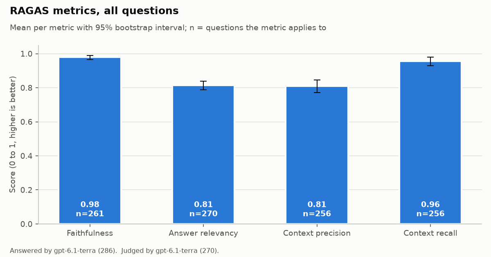
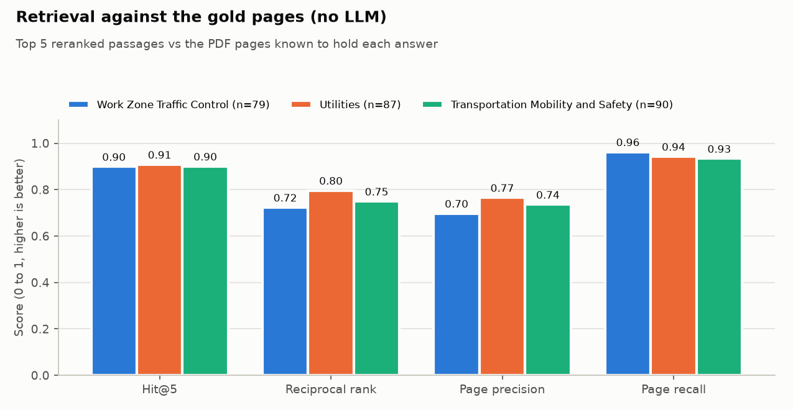

# RAG evaluation results

Two runs are reported here. The first (18 November 2026) scores the production app on the held-out set with an OpenAI judge: use it for the literature review and for comparisons with published systems. The second (27 October 2026) was the first RAGAS run, on the development questions with a free judge; it is kept for comparison. [METRICS.md](METRICS.md) defines each metric, its sources and how it is measured.

## Held-out set, OpenAI judge (18 November 2026, DAR-650)

### What was measured

- **Questions:** the 286 locked held-out items (`evaluation/heldout/`, three divisions: 91 Work Zone, 97 Utilities, 98 TMSD). 256 are answered by the target division's manuals and 30 must be refused. None of their gold pages is in any development set. The items were not read for this report: only aggregates are reported, as the held-out rules require.
- **Answers:** the ones production gave in the DAR-738 run (`docs/heldout-set/openai-site-dar738.md`): main at b7de568, `gpt-6.1-terra` with the free models behind it, index 3 divisions and 13,257 chunks, rerank 40, top 5. No question was asked again: the judge scored the saved answers.
- **Passages:** a site run keeps the answer and its cited excerpts but not the passages the model read, so they were rebuilt on the same index with the same retriever settings (checked against the run's settings and index hash). All 274 cited excerpts were found in the rebuilt passages; the 28 answers that were retried with a second look got those passages too.
- **Judge:** `gpt-6.1-terra` (reasoning effort none, temperature 0, JSON mode), one call per answer, the same prompt as the October run. The key is a hidden Vercel secret, so the calls went through a temporary token-gated proxy on a preview deployment that forwarded them to OpenAI with the server's key and counted them in the site's monthly spend. The proxy and the preview have been removed.
- **Coverage:** 270/270 judged: the 256 answerable items and the 14 must-refuse items whose reply was not the app's formal refusal. The 16 formally refused must-refuse items need no verdict.
- **Cost:** about $1.28 on the shared spend ledger ($5.88 → $7.16 of the $45 November limit). The estimate from the prompts was $2.42; the replies were shorter than the 1,000 output tokens it assumed.

### Headline numbers

Mean with 95% bootstrap interval; n = questions the metric applies to. The free-judge column is the October run below. It is a different question set, answer model, index and judge, so read it as context, not as a before/after.

| Metric | All (held-out, OpenAI judge) | Work Zone | Utilities | TMSD | Oct 27 dev set, free judge |
|---|---|---|---|---|---|
| Faithfulness | **0.98** [0.97-0.99], n=261 | 1.00 [0.99-1.00], n=85 | 0.97 [0.93-0.99], n=88 | 0.98 [0.95-0.99], n=88 | 0.99 [0.96-1.00], n=84 |
| Answer relevancy | **0.81** [0.79-0.84], n=270 | 0.83 [0.79-0.86], n=86 | 0.80 [0.74-0.84], n=91 | 0.82 [0.77-0.86], n=93 | 0.89 [0.86-0.91], n=85 |
| Context precision | **0.81** [0.77-0.85], n=256 | 0.74 [0.67-0.81], n=79 | 0.84 [0.77-0.91], n=87 | 0.84 [0.78-0.90], n=90 | 0.87 [0.81-0.92], n=85 |
| Context recall | **0.96** [0.93-0.98], n=256 | 0.99 [0.96-1.00], n=79 | 0.93 [0.87-0.98], n=87 | 0.95 [0.91-0.99], n=90 | 0.97 [0.93-1.00], n=85 |
| Gold page in the passages (hit) | **0.90** [0.87-0.94], n=256 | 0.90 [0.82-0.96] | 0.91 [0.85-0.97] | 0.90 [0.83-0.96] | 0.96 [0.92-1.00] (hit@5) |
| Reciprocal rank of the gold page | 0.76 [0.71-0.80] | 0.72 | 0.80 | 0.75 | 0.80 [0.73-0.87] |
| Page precision / page recall | 0.73 / 0.95 | 0.70 / 0.96 | 0.77 / 0.94 | 0.74 / 0.93 | 0.77 / 0.96 |
| Formal refusal of must-refuse items | 0.53 (16/30) | 0.42 (5/12) | 0.60 (6/10) | 0.62 (5/8) | 1.00 (5/5) |

Exact-match scores of the same answers, from the held-out scorer (DAR-738): value right 226/242, cited PDF page right 228/249, confident wrong 7/286, answerable declined 8/256, must-refuse answered 0/30.

Split by item kind: the 256 answerable items score faithfulness 0.98 (n=247) and answer relevancy 0.82; the 14 must-refuse items the model declined in its own words score faithfulness 1.00 and answer relevancy 0.72. Page metrics are on (document, PDF page) pairs, so a page of the right number in another manual is a miss.

Per-division charts for each RAGAS metric: [faithfulness](charts/heldout-openai-site-dar738/faithfulness.png), [answer relevancy](charts/heldout-openai-site-dar738/answer_relevancy.png), [context precision](charts/heldout-openai-site-dar738/context_precision.png), [context recall](charts/heldout-openai-site-dar738/context_recall.png). The per-run table is `docs/heldout-set/ragas-openai-site-dar738.md`.

### Caveats

- **The judge is the answering model.** `gpt-6.1-terra` wrote the answers and graded them, and LLM judges are known to favour their own output, so faithfulness and recall may be optimistic. A judge from another family needs only `--judge-models` (and `JUDGE_PRICE_PER_MILLION` for a model `divrag/spend.py` has no price for); the cached passages are rebuilt and only the 270 judge calls are made again.
- **"Formal refusal" undercounts refusals.** RAGAS's correct-refusal counts only the app's own refusal (`NOT_IN_DOCUMENTS`). The other 14 must-refuse items were declined in the model's own words with a citation, which the held-out scorer counts as refusals (must-refuse answered 0/30). Those 14 are in the faithfulness and relevancy means; RAGAS scores a noncommittal reply low on relevancy, which pulls that mean down.
- **Rebuilt passages.** The passages are the local retriever's on the same index and settings, not a record of what production read. All cited excerpts matching is strong evidence they are the same, but not proof.
- **Answer relevancy uses the app's own small embedding model** (bge-small), as in October, so its level is not comparable with published RAGAS numbers, only between runs of this script.
- **To rerun with a key in `.env`:** `python -m evaluation.heldout.ragas --report docs/heldout-set/openai-site-dar738.json --judge-base-url https://api.openai.com/v1 --judge-models gpt-6.1-terra` with `JUDGE_API_KEY`. It sends the same request the proxy did (`max_completion_tokens`, reasoning effort none). Per-item verdicts and scores stay in the gitignored `evaluation/heldout/results/`.

## Development set, free judge (27 October 2026)

Run against the index of that day (758 chunks; Work Zone Traffic Control and Utilities). `results/scores.json` has every question's scores. The run is reproducible from `results/cache.jsonl` with `python -m evaluation.run_ragas --stage report`.

### What was measured

- **Questions:** 90 (`testset.json`). 85 are answered by the manuals (52 Work Zone, 33 Utilities): 70 known-page questions, 13 table questions and 2 from the TMP test set. The other 5 (Q9, N1-N4) are not answered by the asked division's documents.
- **Answers:** the hosted app's own pipeline and settings: retrieval in the asked division only, rerank, top 5, the same prompt, citation check, retry and refusal as `/api/ask`. All 90 answers came from `nvidia/nemotron-3-ultra-550b-a55b:free` on OpenRouter. Its fallbacks (Nemotron Super, Gemma 4 31B) were never needed.
- **Judge:** one JSON call per answer on a free OpenRouter model from a different family. The configured judge was `google/gemma-4-31b-it:free`, but it was rate-limited upstream throughout the run, so OpenRouter's fallback `dots-studio/dots-3-note-preview:free` scored all 85 verdicts. No local or paid model was used.
- **Coverage:** 90/90 questions answered or refused, 85/85 judged. A refused question the documents don't answer needs no verdict.

### Headline numbers

Mean with 95% bootstrap interval; n = questions the metric applies to.

| Metric | All | Work Zone | Utilities |
|---|---|---|---|
| Faithfulness | **0.99** [0.96-1.00], n=84 | 0.98 [0.94-1.00], n=52 | 1.00 [1.00-1.00], n=32 |
| Answer relevancy | **0.89** [0.86-0.91], n=85 | 0.91 [0.89-0.92], n=52 | 0.85 [0.79-0.89], n=33 |
| Context precision | **0.87** [0.81-0.92], n=85 | 0.92 [0.86-0.97], n=52 | 0.80 [0.69-0.90], n=33 |
| Context recall | **0.97** [0.93-1.00], n=85 | 0.99 [0.98-1.00], n=52 | 0.93 [0.84-1.00], n=33 |
| Gold page in top 5 (hit@5) | **0.96** [0.92-1.00], n=85 | 1.00, n=52 | 0.91 [0.79-1.00], n=33 |
| Reciprocal rank of the gold page | 0.80 [0.73-0.87] | 0.81 | 0.78 |
| Page precision / page recall | 0.77 / 0.96 | 0.79 / 0.99 | 0.75 / 0.91 |
| Table questions graded correct | 0.92 (12/13) | 0.92 (12/13) | - |
| Correct refusal (not in the documents) | **1.00** (5/5) | 4/4 | 1/1 |

Outcomes: 78 answered with citations, 6 answered without a valid citation (shown in the app as "No source cited"), and 6 refused. Five of the refusals are correct; one (U14) is a question the manual does answer.

**Answer time** (question in to checked answer out): median 2.1 s, 90th percentile 5.6 s, maximum 11.7 s (n=90). The LLM call is most of it (median 1.6 s), then reranking (0.4 s); embedding and the citation check take milliseconds.

Per-division charts for each RAGAS metric: [faithfulness](charts/faithfulness.png), [answer relevancy](charts/answer_relevancy.png), [context precision](charts/context_precision.png), [context recall](charts/context_recall.png).

### What went wrong

- **One unsupported answer (Q6):** "At 70 mph, what's the smallest radius the table gives a correction factor for?" The app answered "380 ft" with no citation. The table's 70 mph column stops at 1640 ft. This is the one table question graded wrong and the only answer the judge found unfaithful.
- **Six uncited answers, all Work Zone table lookups** (Q1, Q2, Q4, Q6, H3, TMP9): the model gave a bare value ("23 ft") without a `[n]` marker. Five of the six are correct and supported. The app keeps them and flags them rather than refusing.
- **One wrong refusal (U14):** the performance bond rule (UAM p. 40) did not reach the top 5. The retry with the next model did not produce an answer either.
- **Three Utilities page misses** (U7, U14, U19): for U7 the app cited the form itself in Appendix C (p. 198) instead of the gold page's list of forms, which still answers the question. U19 (the manual's intended audience) was answered from the introduction (p. 11) instead of the gold page (p. 144), so the answer is vaguer than the reference.
- **Partial context recall** on a few multi-part questions (X1, Q4, TMP9), where one statement of the reference was not in the passages.

### Caveats

- **The judge is a free preview model.** dots-3-note-preview is not one of the judges the LLM-as-a-judge literature validated. Faithfulness and recall near 1.0 should be read as "no problems found by this judge", not as human-checked. A rerun with a stronger judge needs only `--judge-base-url https://api.openai.com/v1 --judge-models gpt-4o-mini` and `JUDGE_API_KEY`. Cached answers are reused, so only the 85 judge calls are made again.
- **Answer relevancy uses the app's own small embedding model** (bge-small) rather than RAGAS's default OpenAI embeddings, so its absolute level is not comparable with published RAGAS numbers. It is comparable between runs of this script.
- **Times were measured from a local machine calling OpenRouter**, with retrieval on the local CPU, not on Vercel. Free-model latency varies with load. During the answer stage five calls hit upstream 504 timeouts; they were left uncached and asked again on the resume pass, so only the successful attempts are in the time distribution.
- **Reference answers** come from the hand-checked "Expected" answers in `hosted/RESULTS-local.md`, the table notes, the TMP test set, or, for the T and U questions, the sentence of the manual holding the key phrase. Some of the extracted sentences carry PDF layout noise (U7's starts mid-sentence). Context recall is only as good as these references.
- **90 questions on two manuals.** The intervals are wide for Utilities (n=33). The test set is built from questions written while the app was being tuned, so it is not a held-out sample.
